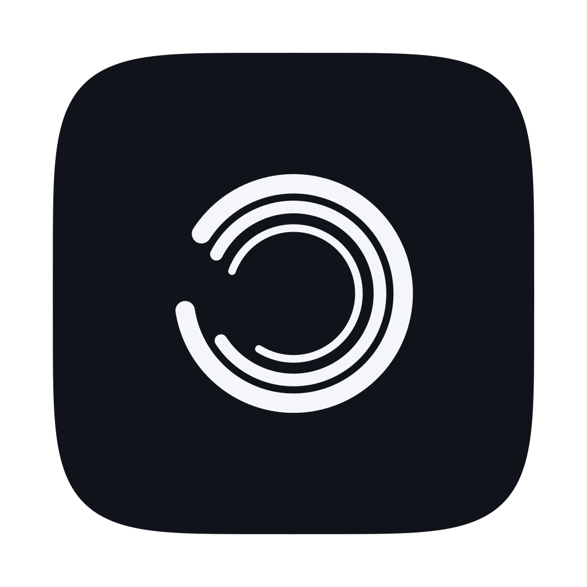
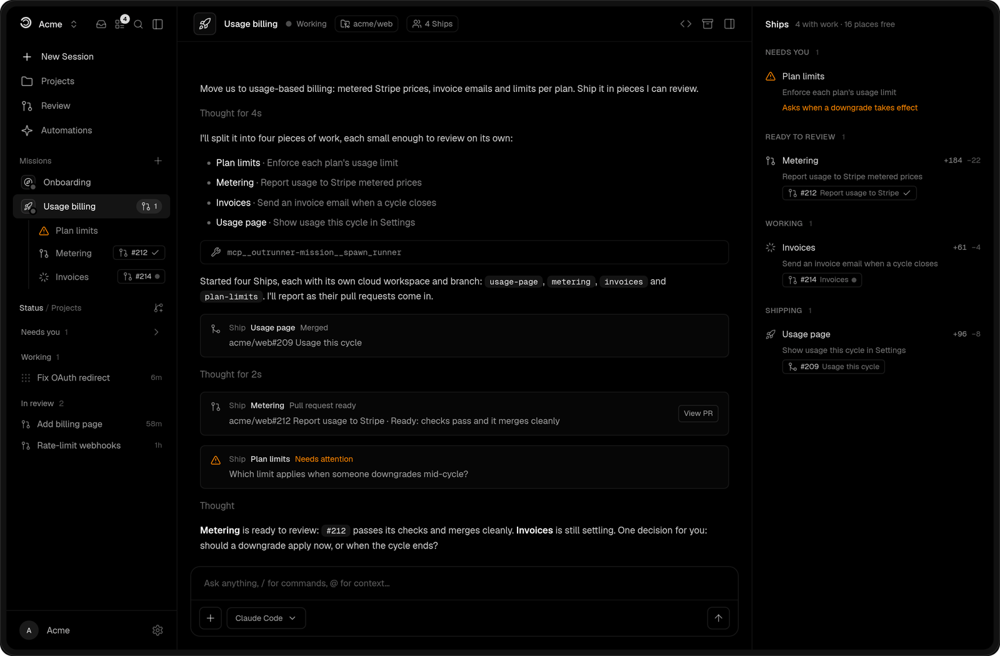

# Outrunner

### Run fleets of cloud coding agents

Claude Code and Codex on many tasks at once, each in its own cloud box, branch and worktree. 
Hand off a task, get back a pull request.

[**Download for macOS**](https://downloads.outrunner.sh/outrunner/Outrunner.dmg) &nbsp;&bull;&nbsp; [outrunner.sh](https://outrunner.sh) &nbsp;&bull;&nbsp; [Docs](https://outrunner.sh/docs) &nbsp;&bull;&nbsp; [Open the web app](https://app.outrunner.sh)

 

 

Outrunner is open source under the MIT License: [outrunner-sh/outrunner](https://github.com/outrunner-sh/outrunner)

